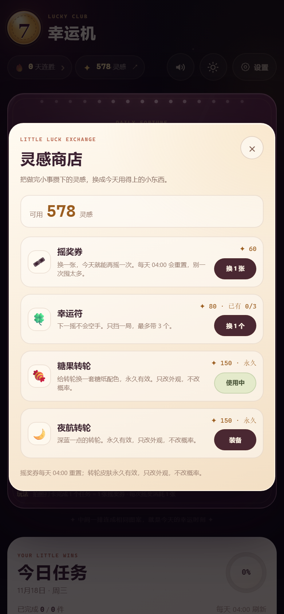
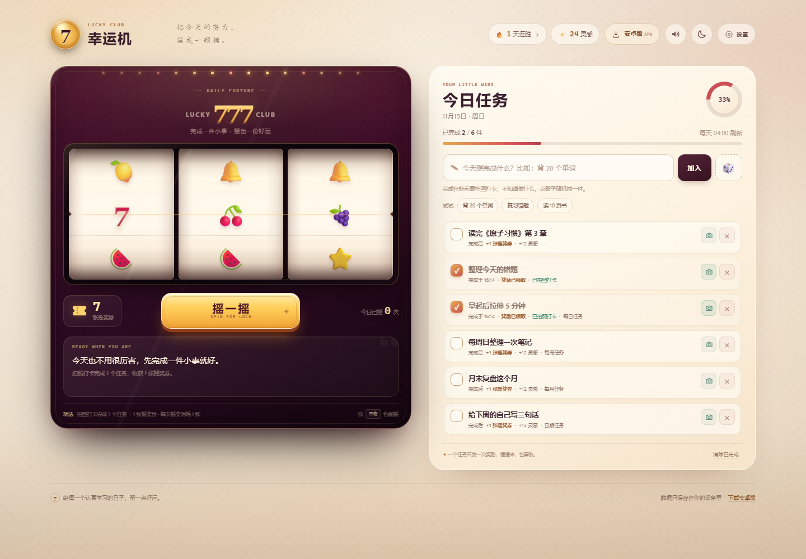
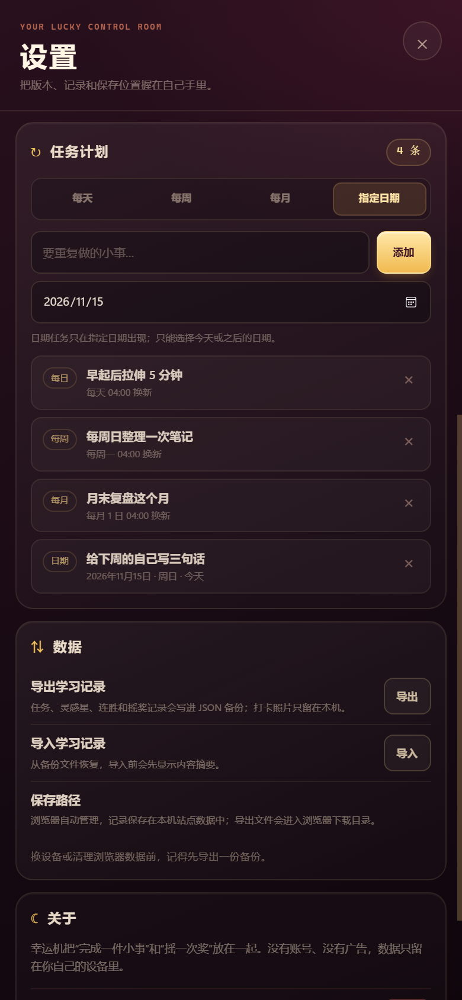

# 幸运机 · 把努力摇成好运


一台可以认真做任务、也可以认真摇奖的老虎机。现在它叫 **幸运机**：每日、每周、每月循环任务会自动出现，日期任务可以提前安排；完成任务换摇奖券，摇出 777、水果与星星。

**当前版本：v1.6.0（versionCode 15）**

- **在线玩：<https://wangji330330-ops.github.io/115/>**
- **安卓安装包：[lucky-study-machine.apk](https://wangji330330-ops.github.io/115/lucky-study-machine.apk)**（Android 7.0+，离线可玩）

## v1.6.0 更新内容

- **灵感商店**：点顶部「灵感」数字或设置里的「进店」，可以用灵感兑换摇奖券、幸运符和转轮皮肤。
- **摇奖券**：60 灵感换 1 张，适合灵感多、今天还想再摇一次的时候；券仍按每天 04:00 重置。
- **幸运符**：80 灵感换 1 个，下一摇不会空手；最多带 3 个，用完自动消耗。
- **转轮皮肤**：糖果 / 夜航两种永久皮肤，150 灵感解锁；只改转盘外观，不改中奖概率。
- **不花钱**：所有奖励只在本机生效，没有广告、充值或真实货币。



## v1.5.0 更新内容

- **摇奖鼓励语重写**：不再使用通用模板句，改成更像朋友说话、能落到当天行动上的句子。
- **从效应取意，不做知识卡**：文案借用了聚光灯效应、峰终定律、负面偏差、目标梯度、单纯曝光、幸存者偏差等视角，但不在界面上讲定义。
- **不碰政治与制度**：没有加入任何政治/制度类“主义”，只保留能帮助自己开始、休息、复盘的心理视角。
- 奖励数值和玩法不变。

## v1.4.4 更新内容

- **日历直接滑动**：不再只显示 3 项、也不要求先点「全部」；所有任务直接显示在框内，可上下滑动。
- **任务序号**：每个任务前面标出 1、2、3…序号。
- **任务数量**：右下角保留「全部 N 项」显示当前任务数，仅作统计，不再需要点击。
- 其余功能与 v1.4.3 相同。

## v1.4.3 更新内容

- **顶部标志微调**：金币里的「7」下调 3px。
- **777 字距**：三个「7」之间各留出 2px 间距。
- 其余功能与 v1.4.2 相同。

## v1.4.2 更新内容

- **日历打卡图标**：任务旁边只显示一个小相机图标，点开才查看照片，不再直接显示缩略图。
- **关闭照片更顺**：退出照片查看器时立即返回日历，不再出现图片先闪掉、遮罩停留一下的情况。
- **全部仍在框内**：超过 3 项时在日期框内展开并上下滑动，「全部 / 收起」固定在右下角。
- 其余功能与 v1.4.1 相同。

## v1.4.1 更新内容

- **日历「全部」修复**：不再打开大尺寸弹窗，而是在日期框内展开任务列表，列表可上下滑动；「全部」/「收起」按钮固定在框的右下角，不会被裁切。
- **日历照片**：打卡过的任务会在日历里显示照片缩略图，点击可看大图。
- 其余功能与 v1.4.0 相同。

## v1.4.0 更新内容

- **重复完成不拍照**：奖励已领取过的任务再次完成时直接点任务即可，不会再要求拍照。
- **日历更好读**：日期框只展示前 3 项，字号加大；右下角「全部」打开完整任务弹窗，长列表在弹窗内滚动。
- **亮色 / 深色主题**：音效旁的太阳/月亮按钮切换主题，选择会保存；亮色主题覆盖首页、任务卡、设置和数据面板。
- **安卓流畅度**：安卓版自动关闭环境光斑、噪点、灯泡/品牌持续动画、背景模糊和大面积滤镜，并降低庆祝粒子数量，减少掉帧。
- **照片占用**：打卡照片最长边压缩到 1280px，只存本机；设置 → 数据里会显示照片张数和占用大小，照片仍不参与 JSON 备份。
- 其余功能与 v1.3.0 相同。



## v1.3.0 更新内容

- **拍照打卡**：每个任务完成前需要拍照或从相册选一张图；拍照成功后才算完成，并领取摇奖券和灵感。
- **照片留存**：照片压缩后存在本机 IndexedDB，不上传；学习日历里能看到打卡标记并点开照片回看。
- **日历修复**：任务长文字和很多任务都会留在日期面板的框内；Daily Record 不再显示周几/「今天」，只显示「现在」或「N 天前」，灵感框仍在标题右侧。
- **闪动修复**：摇奖按钮加 520ms 冷却，避免快速连点反复刷新结果区；设置抽屉打开时不再重建计划/更新面板，避免偶发闪动。
- 保留 v1.2.2 的循环任务删除选择、音量提升、04:00 刷新和顶部提示去重。


## v1.2.2 更新内容

- **循环任务删除修复**：每日 / 每周 / 每月任务的删除按钮改为常显、加大，已完成的也能操作。点击 × 后先弹出确认，可选择「仅移除今天」或「删除整个计划」，不会再把任务留成找不到入口的状态。
- 其余功能与 v1.2.1 相同。

## v1.2.1 更新内容

- **默认音量上调**：所有音效统一走更响的总线，默认响度约为旧版的 4 倍（相当于把 20 调到 80），音效更清楚；静音开关保持不变。
- 其余功能与 v1.2.0 相同。

## v1.2.0 更新内容

- **改名**：应用名、网页标题、PWA 名称和安装后的 App 名统一为「幸运机」。
- **任务计划**：设置里新增每日 / 每周 / 每月循环任务和指定日期任务。
  - 每日任务每天 04:00 换新。
  - 每周任务每周一 04:00 换新，整周保留在清单里。
  - 每月任务每月 1 日 04:00 换新，整月保留在清单里。
  - 日期任务只能安排在逻辑上的“今天”及以后，只在指定日期出现。
- **04:00 刷新**：任务、摇奖券和当天的摇奖次数都在每天 04:00 更新；周任务/月任务会在对应周期边界重置完成状态。
- **清除已完成需确认**：点击“清除已完成”会先弹出确认框，取消不会删除任何东西。
- **顶部提示去重**：所有 Toast 改成单条展示 + 4 秒内相同内容不重复弹；连续点“摇一摇”或重复操作不会堆满屏幕。
- **学习日历**：点击顶部连胜天数打开日历，可切换月份、点选任意日期，查看该日灵感获取、摇奖次数与任务完成情况；有记录和已安排任务的日期会显示小圆点。
- **灵感点击刷新**：点击灵感数字只播放数字刷新/滚动效果，不打开弹窗，也不额外弹提示。
- **骰子快速回正**：随机任务骰子的旋转动画控制在 280ms，结束后立刻回到正位，不再卡在倾斜状态。




## 从旧版升级

- v1.0.0 存在启动闪退（打包漏了匿名内部类），无法应用内自救，需要**手动安装一次**新版本。
- 从 v1.1.0 开始可以在设置里应用内更新：下载、SHA-256 校验后直接调起系统安装器。
- Android 不允许普通应用静默覆盖安装自己，系统仍会显示一次安装确认。


## 玩法

- 写下一件今天想完成的小事，也可以点骰子随机抽一条。
- 首次完成一项任务前需要拍照打卡，随后获得 **1 张摇奖券** + **12 颗灵感星**。奖励已领过时再次完成，不需要再拍照。
- 点任务文字、左侧勾选框或右侧相机图标，都会打开拍照打卡面板；可以从相机拍摄，也可以从相册选择。
- 每条任务右侧的 **×** 可以直接移除；每日 / 每周 / 每月循环任务会让你选择「仅移除今天」或「删除整个计划」，已完成状态也能这样处理。
- 摇一次消耗 1 张摇奖券；三个 7 的头彩额外送 3 张摇奖券。
- 每天初始 5 张摇奖券；未使用的券、摇奖次数和每日任务在 04:00 重置。
- 所有记录只存在本机，不上传服务器。

## 设置里有什么

- **版本更新**：当前版本号、最新版本、更新日志、检查更新、应用内下载安装。
- **安装**：网页版安装到主屏幕 / 下载 APK；安卓版显示已安装状态。
- **任务计划**：添加、查看和删除每日 / 每周 / 每月 / 指定日期任务。
- **数据**：JSON 导入 / 导出、导入前摘要确认、跨日期备份按天重置。打卡照片只留在本机，不写进 JSON 备份。
- **保存路径**：安卓版可用系统文件夹选择器指定长期保存目录；网页版由浏览器管理下载位置。
- **清空记录**：二次确认后清空任务、计划、灵感星、连胜、打卡照片和历史。


## 说明

- 逻辑日从每天 **04:00** 开始；凌晨 03:59 仍属于前一天。
- 周任务的周期按周一至周日计算；月任务按自然月计算。
- 日期任务在当天 04:00 进入清单，次日 04:00 从待办清单消失，完成情况会留在学习日历里。
- 安卓版与网页版是不同来源，进度互不相通；清除站点数据或卸载 App 会丢失记录和打卡照片，建议先导出文字备份。
- 打卡照片保存在本机 IndexedDB，不参与 JSON 导入 / 导出；换设备后照片不会跟着走。

## 技术说明

- **网页版**：无框架、无构建依赖；PWA 支持安装到主屏幕，service worker 缓存核心页面。
- **安卓版**：轻量 WebView 壳，页面资源打包在 APK 内，启动时只在本机 `127.0.0.1:17315` 提供静态文件，完全离线。
- **拍照打卡**：网页端把照片压缩到最长边 1280px 后存进 IndexedDB；安卓端通过 `ACTION_IMAGE_CAPTURE` / `ACTION_GET_CONTENT` 调起相机或相册，再用内置 `PhotoFileProvider` 把结果交回 WebView。没有声明 `CAMERA` 权限，由系统相机应用自己完成拍摄。
- **安卓性能模式**：APK 自动给页面加上 `is-android`，关闭高成本的环境光斑、噪点、持续灯泡/品牌动画、背景模糊和部分滤镜，并降低庆祝粒子数量；网页端保留完整效果。
- **应用内更新**：Java 端从 `https://wangji330330-ops.github.io/115/update.json` 读取版本，下载并校验 SHA-256、包名和版本号，再通过 `PackageInstaller` 交给系统。
- **权限**：
  - `INTERNET`：只访问本机静态服务和项目自己的 GitHub Pages 更新源。
  - `REQUEST_INSTALL_PACKAGES`：应用内更新所需；系统安装确认无法跳过。

APK 使用 `apksigner` 签名并通过 v3 签名校验、`zipalign` 对齐校验。

签名证书 SHA-256：

```
04c92bc2ea9c0b0acf7a7fe428e355fb40841172b687965a4f51d717d92d4267
```

## 本地打开

```bash
# 直接双击 index.html，或：
python -m http.server 8000
# http://localhost:8000/
```

## 目录结构

```text
index.html                 页面结构、设置抽屉、任务计划和日历
assets/style.css           全部视觉样式
assets/app.js              转轮、任务计划、04:00 刷新、日历、音效和存档逻辑
assets/icon*               777 App / PWA 图标
manifest.webmanifest       PWA 清单
sw.js                      线上离线缓存
update.json                安卓/网页更新清单
lucky-study-machine.apk    已签名安装包（v1.6.0）
docs/                      预览图
android/                   APK 工程与免 Gradle 构建脚本
  app/src/                 MainActivity、NativeBridge、UpdateManager、
                           DataManager、InstallResultReceiver
  build_apk.py             一条命令构建并签名 APK
tools/make_icons.py        生成 777 图标
```

## 重新构建安卓版

依赖：JDK 17、Android SDK（`platforms/android-35`、`build-tools/35.x`）、Python 3。

```powershell
$env:ANDROID_SDK_ROOT = "C:\path\to\android-sdk"
$env:JAVA_HOME = "C:\path\to\jdk17"
python android/build_apk.py
```

正式签名密钥生成一次后保存在 `android/.signing/`，不提交到 git。**请保留这个目录和密码文件；丢失后将无法用同一个签名覆盖安装更新。**

发布新版本时：提升 Manifest / 构建脚本 / `app.js` / 页面中的版本号 → 构建 APK → 更新 `update.json` 的版本、日志、大小和 SHA-256 → 一起发布。
