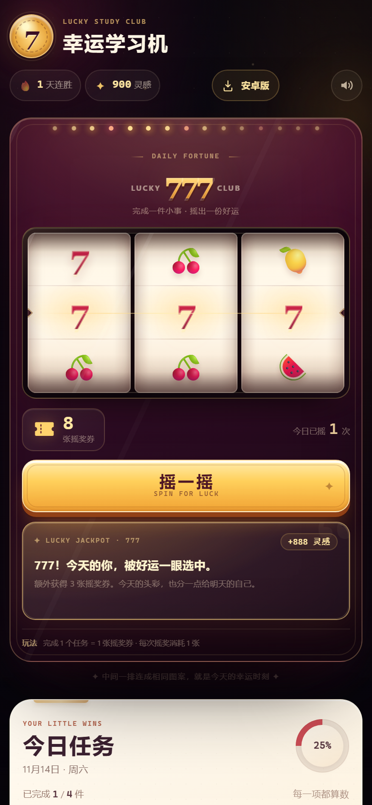

# 幸运学习机 · 把努力摇成好运

一台可以认真做任务、也可以认真摇奖的老虎机。中间一排摇出三个七、三颗星、同款水果或一对图案，就会收获灵感和下一份好运。

**在线玩：<https://wangji330330-ops.github.io/115/>**

**安卓安装包：[lucky-study-machine.apk](https://wangji330330-ops.github.io/115/lucky-study-machine.apk)**（约 0.4 MB，Android 7.0+，离线可玩）


## 它是怎么运转的

- 写下今天真正想完成的小事，也可以点骰子随机抽一条。
- 每完成一项，获得 **1 张摇奖券**，同时收下 **12 颗灵感星**。同一项任务只发一次奖励，重新打勾不会重复刷券。
- 摇一次消耗 1 张摇奖券。中间那一排出现配对或三连，就有额外灵感星；三个 7 的头彩还会送 3 张摇奖券。
- 每天自动获得 5 张初始摇奖券；跨天会清空任务和当日进度，但累计灵感星与连续完成任务的天数会保留。
- 所有记录只存在当前浏览器或 App 的本地存储里，不上传任何服务器。

## 图案与手感

- 7 个转轮图案：幸运七、🍒、🍋、🍇、🍉、🔔、⭐。
- 三个转轮分别加速、减速、停稳，带上机械咔哒声、落定声、中奖小旋律与头彩号角。
- 头彩、对子、任务完成会撒下彩纸；没有连成线也会收到 5 颗勇气星和一句不太敷衍的鼓励。
- 音效由 Web Audio 实时合成，不依赖任何音频文件。第一次点击页面后才会启动，右上角可随时静音。
- 按 `空格键` 也能摇；数据存在 `localStorage`，刷新不丢。



## 网页版与安卓版

- **网页版**：无需构建、无外部依赖，直接打开 `index.html` 就能用。线上版本支持安装到主屏幕（PWA）。
- **安卓版**：一个轻量 WebView 壳，把同一份网页资源打进 APK。App 启动时只在 `127.0.0.1` 上起一个只读静态文件服务，既保证 `localStorage` 有一个稳定来源，又完全离线。固定端口为 17315。

APK 已使用 `apksigner` 签名并通过 v3 签名校验和 `zipalign` 校验。

签名证书 SHA-256：

```
04c92bc2ea9c0b0acf7a7fe428e355fb40841172b687965a4f51d717d92d4267
```

## 本地打开

```bash
# 最简单：双击 index.html

# 或启动一个本地服务器
python -m http.server 8000
# 打开 http://localhost:8000/
```

## 目录结构

```text
index.html                 页面结构
assets/style.css           全部视觉样式
assets/app.js              转轮、任务、音效、彩纸和存档逻辑
assets/icon*.png           PWA / Android 图标
manifest.webmanifest       PWA 清单
sw.js                      线上环境的离线缓存
lucky-study-machine.apk    已签名安卓安装包
docs/                      预览图
android/                   APK 工程与免 Gradle 构建脚本
  app/                     Manifest、Java、资源
  build_apk.py             一条命令构建并签名 APK
tools/make_icons.py        重新生成图标（需要 Pillow）
```

## 重新构建安卓版

依赖：JDK 17、Android SDK（`platforms/android-35`、`build-tools/35.x`）、Python 3。

```powershell
$env:ANDROID_SDK_ROOT = "C:\path\to\android-sdk"
$env:JAVA_HOME = "C:\path\to\jdk17"
python android/build_apk.py
```

脚本会把工程临时复制到一个纯英文路径（`aapt2` 在 Windows 上无法处理中文资源路径），依次执行 aapt2 → javac → d8 → zipalign → apksigner，最后把 APK 复制到仓库根目录。正式签名密钥生成一次后保存在本地的 `android/.signing/`，不会提交到 git。**请保留这个目录和密码文件；丢失后将无法用同一个签名覆盖安装更新。**

## 数据说明

- Web 端存储键：`lucky-study-machine.v1`
- 安卓版与网页版是不同的来源（origin），进度互不相通。
- 清除浏览器站点数据或卸载 App 会清空任务和灵感星。
- 安卓安装包申请的唯一权限是 `INTERNET`，仅用于访问 App 自己在本机启动的 `127.0.0.1` 静态文件服务；页面不会发起外网请求。
