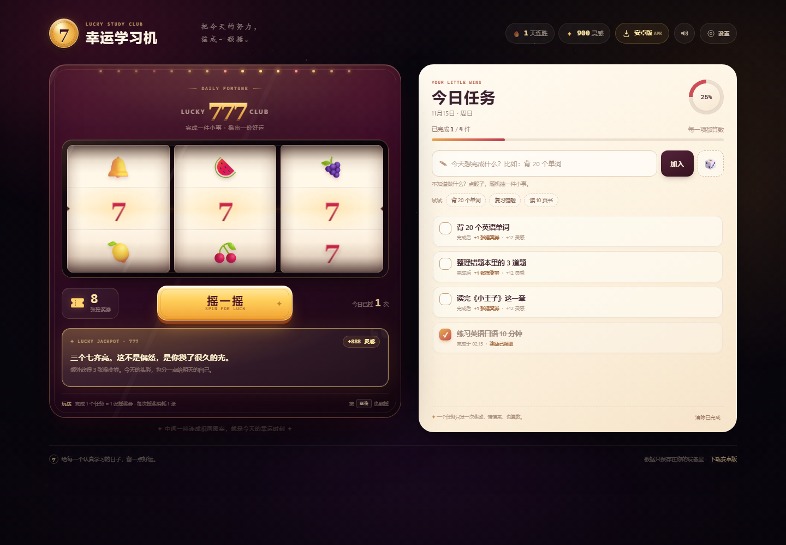

# 幸运学习机 · 把努力摇成好运


一台可以认真做任务、也可以认真摇奖的老虎机。中间一排摇出三个七、三颗星、同款水果或一对图案，就会收获灵感和下一份好运。

**当前版本：v1.1.2（versionCode 4）**

- **在线玩：<https://wangji330330-ops.github.io/115/>**
- **安卓安装包：[lucky-study-machine.apk](https://wangji330330-ops.github.io/115/lucky-study-machine.apk)**（约 0.34 MB，Android 7.0+，离线可玩）

## v1.1.2 更新内容

- **任务区恢复整页滚动**：任务列表不再套一层自己的滚动容器，手指从任务文字上开始拖动也能正常上下滑页面。
- **整行任务可点**：点击任务正文即可完成 / 取消完成，不用再精确点小方框；滑动页面时做了防误触处理。
- **主页上方不再刷新**：移除了标题处的首页链接，点击老虎机上方的空白处不会重载页面或闪屏。
- **删掉黄色装饰条**：“今日任务”卡片上方突出的小黄条已移除。
- 继续保留 v1.1.1 的 777 封面、禁止缩放、去选中框和设置入口修复。

## 之前的重点修复

- **锁定界面缩放**：安卓版关闭 WebView 双指/双击缩放、自动适配和系统文字缩放；网页 viewport 也设置了 `user-scalable=no`。
- **777 应用封面**：App 图标、PWA 图标和 favicon 是三个摆正、均匀分布的 7。
- **去掉选中框**：点击、长按不再出现焦点金框、文字选中框或长按菜单；键盘操作仍保留焦点样式。
- **设置入口**：标题旁的金色 7 已摆正；右上角是带“设置”文字的胶囊按钮，关闭设置后页面会立即恢复可点。
- **没票不跳转**：摇奖券不足时只提示先完成任务，不自动滚动页面。



## 从 1.0.0 升级

- v1.0.0 存在启动闪退：打包时漏掉了 Java 匿名内部类。这个问题在 v1.1.0 已修复。
- 从 v1.1.0 开始可以在应用内更新；如果你现在还是 v1.0.0，需要**手动安装一次**新版本（旧版无法应用内自救）。
- 装好带更新器的版本后，后续版本可以在设置里直接检查更新、下载并调起系统安装器。
- Android 不允许普通应用静默覆盖安装自己，系统最后仍会显示一次安装确认；但不需要再自己去文件管理器找 APK。


## 玩法

- 写下今天真正想完成的小事，也可以点骰子随机抽一条。
- 每完成一项，获得 **1 张摇奖券**，同时收下 **12 颗灵感星**。同一项任务只发一次奖励。
- 摇一次消耗 1 张摇奖券。中间一排出现配对或三连，就有额外灵感星；三个 7 的头彩还会送 3 张摇奖券。
- 每天自动获得 5 张初始摇奖券；跨天清空任务和当日进度，累计灵感星与连续天数保留。
- 所有记录只存在当前浏览器或 App 的本地存储里，不上传任何服务器。

## 图案与手感

- 7 个转轮图案：幸运七、🍒、🍋、🍇、🍉、🔔、⭐。
- 三个转轮分别加速、减速、停稳，带上机械咔哒声、落定声、中奖小旋律与头彩号角。
- 头彩、对子、任务完成会撒下彩纸；没有连成线也会收到 5 颗勇气星和一句不太敷衍的鼓励。
- 音效由 Web Audio 实时合成，不依赖任何音频文件；第一次点击后启动，右上角可随时静音。
- 按 `空格键` 也能摇；数据存在 `localStorage`，刷新不丢。


## 设置里有什么

- **版本更新**：版本号、最新版本、更新日志、检查更新、应用内下载并调起系统安装器。
- **安装**：网页版可安装到主屏幕或下载 APK；安卓版显示已安装状态。
- **数据**：JSON 导入/导出、导入前摘要确认、跨日期备份按天重置。
- **保存路径**：安卓版可用系统文件夹选择器指定长期保存目录；网页版由浏览器管理下载位置。
- **清空记录**：二次确认后清空任务、灵感星、连胜和历史。
- **任务交互**：点整行勾选 / 取消；滑动任务区不会误触；页面统一滚动，不嵌套滚动条。

## 网页版与安卓版

- **网页版**：无需构建、无外部依赖，直接打开 `index.html`；线上版本支持安装到主屏幕（PWA），并用 service worker 缓存核心页面。
- **安卓版**：轻量 WebView 壳，把网页资源打进 APK。启动时只在 `127.0.0.1:17315` 上起一个只读静态文件服务，保证 `localStorage` 来源稳定、完全离线。
- **应用内更新**：更新源为 `https://wangji330330-ops.github.io/115/update.json`。Java 端下载并校验 SHA-256、包名和版本号，再通过 `PackageInstaller` 交给系统。

APK 已通过 `apksigner` v3 签名校验和 `zipalign` 对齐校验。

签名证书 SHA-256：

```
04c92bc2ea9c0b0acf7a7fe428e355fb40841172b687965a4f51d717d92d4267
```

## 本地打开

```bash
# 最简单：双击 index.html
# 或启动一个本地服务器
python -m http.server 8000
# 打开 http://localhost:8000/
```

## 目录结构

```text
index.html                 页面结构和设置抽屉
assets/style.css           全部视觉样式
assets/app.js              转轮、任务、音效、设置、更新与备份逻辑
assets/icon*.png / .svg    777 App / PWA / favicon 图标
manifest.webmanifest       PWA 清单
sw.js                      线上环境的离线缓存
update.json                更新清单（版本、日志、APK 地址、SHA-256）
lucky-study-machine.apk    已签名安卓安装包（v1.1.2）
docs/                      预览图
android/                   APK 工程与免 Gradle 构建脚本
  app/                     Manifest、Java、资源
  app/src/                 MainActivity、NativeBridge、UpdateManager、
                           DataManager、InstallResultReceiver
  build_apk.py             一条命令构建并签名 APK
tools/make_icons.py        生成 777 图标（需要 Pillow）
```

## 重新构建安卓版

依赖：JDK 17、Android SDK（`platforms/android-35`、`build-tools/35.x`）、Python 3。

```powershell
$env:ANDROID_SDK_ROOT = "C:\path\to\android-sdk"
$env:JAVA_HOME = "C:\path\to\jdk17"
python android/build_apk.py
```

脚本会把工程临时复制到纯英文路径（Windows 上的 aapt2 无法处理中文资源路径），依次执行 aapt2 → javac（全部 Java 源文件）→ d8（全部 class 文件）→ zipalign → apksigner，最后把 APK 复制到仓库根目录。

正式签名密钥生成一次后保存在 `android/.signing/`，不会提交到 git。**请保留这个目录和密码文件；丢失后将无法用同一个签名覆盖安装更新。**

发布新版本时：

1. 同时提升 `android/app/AndroidManifest.xml`、`android/build_apk.py`、`assets/app.js` 和页面静态版本号。
2. 重新构建 APK。
3. 更新 `update.json` 的 `versionCode`、`versionName`、`notes`、`size`、`sha256`。
4. 把 APK 与 `update.json` 一起发布。

## 数据说明

- Web 端存储键：`lucky-study-machine.v1`
- 安卓版与网页版是不同的来源（origin），进度互不相通。
- 清除浏览器站点数据或卸载 App 会清空任务和灵感星；建议先在设置里导出备份。
- 安卓安装包申请：
  - `INTERNET`：只访问 App 自己的本机静态服务与项目自己的 GitHub Pages 更新源。
  - `REQUEST_INSTALL_PACKAGES`：应用内更新所需；系统安装确认无法跳过。
